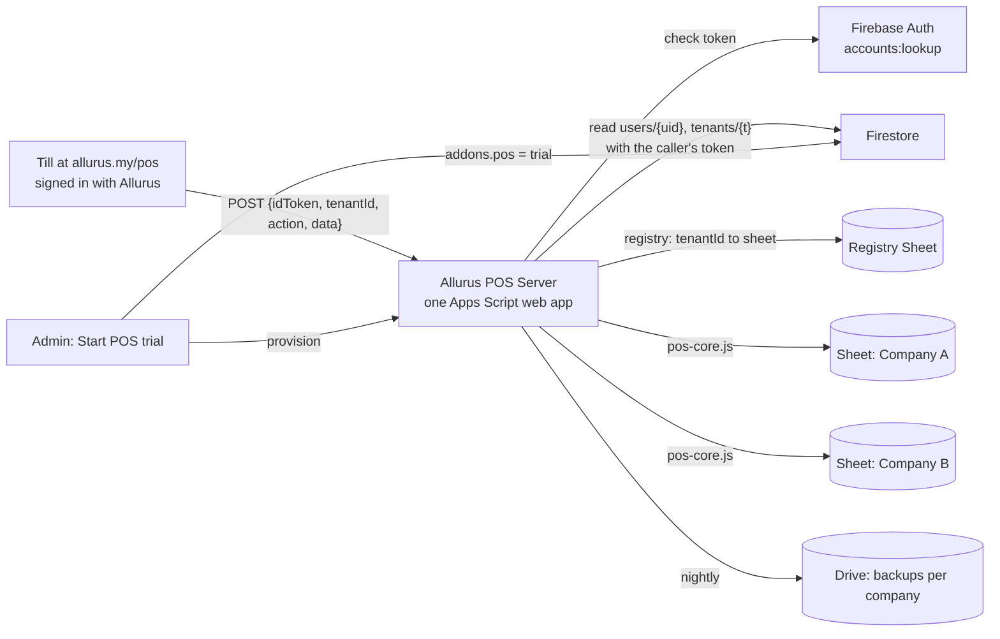

# Allurus POS Live, with client data in Google Sheets via Apps Script (Instructions for the coding agent)

## Owner's decision (7 Nov 2026)
Publish the POS **live** for real Allurus companies. **Each client's POS data is saved in Google Sheets through Apps Script**, not in Firestore. This replaces sections 4, 5 and 9 of `POS-LIVE-FLOW-SPEC.md` (Firestore POS data, the `posCafe` Cloud Function and practice mode). The rest of that spec still applies: the trial switch-on, POS roles in the Access panel, the till at `allurus.my/pos`, trial end and reminders, superadmin list, security.

Why this works without the Blaze plan: Apps Script runs on Google's servers, so **prices, totals, stock and receipt numbers are still worked out on the server** (the same `pos/shared/pos-core.js` engine as today). Real trading is allowed. **No practice mode** is needed.

## Answer to the agent's question
Yes: build the **"Start POS trial" button** next, and have it create the company's Google Sheet through Apps Script (below). Don't ship the Firestore POS data collections or the Firestore practice host from `claude/pos-live`. Keep only the trial flag (`addons.pos`, `AllurusPosTrial`) and its rules.

## How it fits together

- **One central Apps Script project** ("Allurus POS Server"), owned by Allurus's Google account, deployed as a web app (Execute as: Me; Who has access: Anyone).
- **One Google Sheet per company**, created from code (tabs `Settings`, `Products`, `Recipes`, `Stock`, `Moves`, `Sales`, `SaleItems`, `Waste`, `Purchases`, `Containers`, `Audit`, using the tabs `pos-core.js` already needs), kept in Drive folder `Allurus POS clients/<tenantId>`.
- **A registry Sheet**: `tenantId, spreadsheetId, outletName, createdAt, createdByUid, status, lastSaleAt`. The browser never sees spreadsheet IDs.
- **No `SECRET_KEY` in the browser** for live mode. The caller proves who they are with their **Firebase ID token**.

## 1. Who is calling (every request)
1. The till sends `{ idToken, tenantId, action, data }` as `text/plain` POST (no CORS preflight, as now). It gets a fresh token from `auth.currentUser.getIdToken()` before each call (Firebase refreshes it).
2. Apps Script checks the token with **Firebase Auth REST** `accounts:lookup` (Web API key in Script Properties) and gets `uid`. A bad or expired token gets the generic "Not allowed".
3. It reads **`users/{uid}`** and **`tenants/{tenantId}`** from **Firestore REST using the caller's own token**, so the existing rules decide what it may read. Check that the profile's `tenantId` matches, the account isn't `disabled`, and the `posRole` (or Owner / `pos` area → manager).
4. Company status: billing `effective()` must be trial/active/past_due, and `addons.pos.status` must be `trial` (with `trialEndsAt` in the future) or `active`. Otherwise: read actions only, then "Your POS trial has ended."
5. **Cache** the result of steps 2 to 4 in `CacheService` for 5 minutes, keyed by a hash of the token (never the token itself). A removed POS role therefore stops working within 5 minutes. Manager-only money actions (void, price change, stock adjust) **re-check without cache**.
6. Action allowed by role (same table as `POS-LIVE-FLOW-SPEC.md` section 2): manager everything; cashier sell, receipt, bar ticket, today, log waste; waiter orders; kitchen tickets. Anything else gets "Not allowed".
7. Write one `Audit` row per write: time, uid, action, ids. Never the token, PINs, IC or phone.

## 2. One engine for everything
- `pos/shared/pos-core.js` gets a **Sheet host that takes a `Spreadsheet` object** (`SpreadsheetApp.openById(id)`), instead of `getActiveSpreadsheet()`. The single-cafe bound script (`Code.gs`) keeps working by passing its own spreadsheet.
- `PosCore.gs` stays a synced copy, with the parity test. Add `pos/apps-script-server/` for the central project: `Router.gs` (doPost, auth, roles, registry), `Provision.gs`, `Backup.gs`, plus the synced `PosCore.gs`.
- Company settings (outlet name, SST rate and number, service charge, receipt header and footer, currency, low-stock level) live in the company Sheet's `Settings` tab, not in Script Properties.
- Same `sale_id` saved once (per company Sheet), as now.

## 3. Locking and speed
- Today `Code.gs` uses `LockService.getScriptLock()`. In one central project that lock is shared by **all companies**, so sales from different cafes wait for each other. Keep the locked part as short as possible: check the token and roles, read the products and work out totals **before** taking the lock. Take the lock only to check `sale_id`, write the rows and move stock. Measure: milliseconds per sale with the lock, and sales per minute for 1, 5 and 20 tills at once (a load-test script). Write the numbers in the log.
- Google's published Apps Script limits that matter here (the web app runs as one account, so all companies share them):
  - 30 executions at the same time per user;
  - 6 minutes per execution;
  - URL Fetch calls per day: 20,000 on a gmail.com account, 100,000 on Google Workspace (each request uses up to 2 to 3 for token and Firestore checks; the cache cuts this);
  - trigger run time per day: 90 minutes (gmail) or 6 hours (Workspace);
  - spreadsheets created per day: 250 (gmail) or 3,200 (Workspace).
- Add a **daily usage row** in the registry (requests, URL Fetch calls used, average ms). Show it on the superadmin page and warn at 70% of the daily URL Fetch limit.
- From the load test, write in the log a plain answer: "about N busy outlets before we must move off Apps Script". The `PosHost` design means moving to Firestore or Postgres later is a host swap, not a rewrite.

## 4. Start POS trial (provision)
- Button on the admin dashboard and in Settings → Add-ons (as in `POS-LIVE-FLOW-SPEC.md` section 1). Dialog: outlet name, SST yes/no, rate and number, service charge, receipt texts, "Start with sample menu" or "Start empty".
- The browser calls Apps Script `provision` with the admin's token. Apps Script checks the caller is **Owner or has the Settings area** for that tenant, then:
  1. if the registry already has this tenant, returns it (no second Sheet; double-click safe);
  2. creates the Sheet in `Allurus POS clients/<tenantId>`, named `Allurus POS – <company name> – <tenantId>`;
  3. creates the tabs and headers, fills `Settings`, and loads the sample menu if asked (items marked "(sample)");
  4. adds the registry row.
- Then the browser sets `addons.pos = { status: 'trial', trialEndsAt (30 days, AllurusBilling.trialEnd), startedBy, startedAt }` on the tenant, and turns on the `pos` feature. Rules: Owner or Settings area may set it **once**, only to `trial`, with `trialEndsAt` no later than 30 days ahead. Only superadmin sets `active`, `paidUntil` or extends.
- The starter becomes POS manager. Next-step screen: "Give staff a POS role" and "Open the till".
- If `provision` fails half way, it can be run again safely and finishes the job.

## 5. The till (`allurus.my/pos`)
- `pos/api-live.js`: the same `window.PosApi` surface as `api.js` and `api-demo.js`, calling the central web app with the ID token and `tenantId`. `API_URL` (the `/exec` URL) is public config in the repo. It is not a secret, because every call needs a valid Allurus sign-in.
- Mode choice (one place in `index.html`): `/demo/pos` → demo; `/pos` → live (Allurus sign-in). The Sheet-with-secret-key mode stays for local single-cafe use only, never served on allurus.my.
- Sign-in: reuse the HR app's Firebase sign-in (email, or company code + IC + password/PIN). Never store the password or PIN on the device. A person in more than one company picks one.
- Offline: keep the queue and the same `sale_id` retry. Show "Offline: N sales waiting".
- CSP for `/pos`: `connect-src` = own origin, `https://script.google.com`, `https://script.googleusercontent.com` (Apps Script web apps redirect there), and the Firebase Auth and Firestore endpoints. Test that the redirect works with `fetch` and `text/plain` POST, as the current `api.js` does.
- Errors: Apps Script sometimes answers slowly or with an HTML error page. Treat a non-JSON answer as "Not saved. Try again", with the same `sale_id`, as today.

## 6. Backups, export, Finance
- **Nightly backup**: one time trigger loops the registry and copies each company Sheet into `Allurus POS backups/<tenantId>`, keeping the newest 30. Do it in batches with a saved position so one run stays under 6 minutes and the daily trigger-time limit, and continue the next night if needed. Log any company not backed up in 2 days.
- **Export for the client**: managers get "Download my POS data" (Excel copy of their Sheet, made by Apps Script, returned as a temporary download). Don't share the live Sheet with clients by default. Sharing view-only with the company Owner's email is an option the owner decides later.
- **Finance**: phase 1 = manager presses **"Close day"**. The till reads the day summary from Apps Script and writes **one Finance entry per day per payment method** to Firestore (`source: 'pos'`), keyed by date so it never posts twice. Rules: POS managers in that tenant may create these entries only.
- **Operations stock**: phase 1 = POS stock stays in the POS. Show a read-only "POS stock" page in Operations through Apps Script. Merging is later.

## 7. Trial end, paying, removal
As in `POS-LIVE-FLOW-SPEC.md` section 7: reminders on day 23/27/30, then read-only plus export. Paid → superadmin sets `active` with `paidUntil`. After 90 days unpaid: notice, then **deleting the Sheet waits for the owner** (hard stop 1). Apps Script enforces read-only too (section 1, step 4).

## 8. Security and privacy
- Client POS data sits in **Allurus's Google Drive**. Update the privacy notice and client terms: Allurus stores POS data in Google Sheets on Google's servers as processor for the client. The owner has to approve the wording.
- Use a **Google Workspace account for Allurus** (for example `pos@allurus.my`), not a personal Gmail: higher limits (section 3), and the data isn't tied to one person's private account. Owner action.
- Script Properties: `FIREBASE_API_KEY`, `FIREBASE_PROJECT_ID`, `REGISTRY_ID`, `CLIENTS_FOLDER_ID`, `BACKUPS_FOLDER_ID`. No passwords, no service-account keys.
- No card data (as now). No customer personal data on receipts.
- The join-page security gaps in `AUTOPILOT-LOG.md` must be fixed before real companies trade (see `POS-LIVE-FLOW-SPEC.md` section 8). Until then, POS roles only for people who joined by email invitation or a personal link.

## 9. Owner steps (write them in the log, in order)
The agent cannot do these because they need the owner's Google account:
1. Choose the Google account that owns the POS server (Workspace recommended).
2. Create the Apps Script project and the two Drive folders, or run `npx @google/clasp login` and let the agent push with `clasp push` from `pos/apps-script-server/`.
3. Fill in Script Properties (section 8).
4. Deploy > New deployment > Web app (Execute as Me, Anyone). Copy the `/exec` URL into the repo config. After code changes: Manage deployments > edit > **New version** (same URL).
5. Run `installTriggers` once (nightly backup).
6. Approve the privacy and terms wording.

## Tests (before saying it's done)
- Node tests with fake `SpreadsheetApp`, `UrlFetchApp`, `CacheService`, `LockService`, `DriveApp`:
  - bad token, token for another company, disabled account, no POS role → "Not allowed";
  - cashier can't change prices or void; manager can;
  - expired POS trial → reads work, writes refused;
  - two companies → each request touches only its own Sheet;
  - the same `sale_id` twice → one sale;
  - `provision` twice → one Sheet; `provision` by a non-admin → refused.
- Parity: the same sale cases give the same results in the demo host, the single-cafe Sheet and the central server.
- Load test numbers in the log (section 3).
- Rules tests for `addons.pos`: Owner/Settings can start a trial once, can't set `active` or extend; superadmin can.
- Till: sign in at `/pos` (email and IC staff), sell, receipt, void by manager, offline queue, Close day → one Finance entry.
- `/demo/pos` unchanged (no network calls).
- `npm test`, `npm run test:rules` and `pos/tests` pass.

## Order of work
1. Merge `claude/pos-demo`.
2. Engine host by spreadsheet ID + central server (Router, auth, roles, registry) with tests.
3. Provision + "Start POS trial" button + `addons.pos` rules.
4. `api-live.js` + `/pos` sign-in + CSP.
5. Backups, export, Close day → Finance, superadmin list with usage.
6. Owner steps (section 9), then go live with one test company, then Major Far East or the first café.

## Working style
Follow `RUN-ALL-SPECS.md` (full permission, hard stops, safety steps, log). One pull request per step. Write each preview link and every owner step in `docs/AUTOPILOT-LOG.md`.
