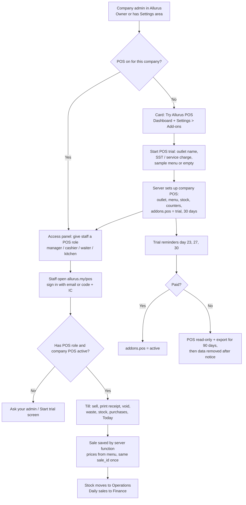

# Allurus POS Live: any Allurus company can switch on the cafe POS and use it (Instructions for the coding agent)

## Goal
Today the cafe till (`pos/`) works in two ways only: the public demo (`/demo/pos`, data in one browser) and one cafe's Google Sheet (Apps Script plus a secret key in `config.js`). Neither works for many companies.

Make it **live for every company on Allurus**:
1. A company admin presses **"Start POS trial"** inside Allurus.
2. Their company gets its own POS (menu, stock, sales), saved in **their company's Firestore data**, separate from every other company.
3. Their staff sign in with their **existing Allurus login** (email, or company code + IC) and use the till on a phone, tablet or PC at `allurus.my/pos`.
4. Sales flow into Allurus Finance, and stock into Operations. Cashiers are the same people as in HR.
5. The trial ends after 30 days with reminders. Paid companies keep going. Nobody loses data.

`/demo/pos` stays as it is: public, no login, browser only.

## Build on what exists (confirm in the code)
- **Branch `claude/pos-demo`** (not merged yet): `pos/shared/pos-core.js` holds all money, stock, recipe, waste, purchase and container logic, and takes a **`PosHost`** (storage backend). Hosts today: the Google Sheet (Apps Script) and `localStorage` (demo). `PosCore.gs` is a synced copy, with `core-parity.test.js`. **Merge this branch first** (pull request, tests passing).
- **HR app**: Firebase Auth, tenants, roles and areas (`pos` area, `posRole`: manager, cashier, waiter, kitchen), billing trial logic (`js/billing-rules.js`: 30-day trial, 7-day grace, 90-day keep), features per company (`window.AllurusFeatures`, industry extras), Finance (`state.finance.txns`), Operations stock.
- **The HR app's other POS** (`js/pos.js`, `js/pos-rules.js`, `functions/pos-core.js`, rules `pos_outlets`, `pos_menu`, `pos_orders`, `pos_payments`, ...). It is multi-tenant and has tables, kitchen, shifts and card-terminal outcomes, but no recipes, ingredient stock, waste or purchases. **Don't build a third POS.** The cafe till (`pos/`) is the product (owner's decision). Reuse the HR POS's rules ideas, roles, shift and payment-outcome model where they fit. In the log, write a plan to retire `js/pos.js` later or fold its tables/kitchen/shift features into `pos/`. Don't delete it in this task.

## The flow

### 1. Switch it on (company admin)
- Show a **"Try Allurus POS"** card on the admin dashboard and in **Settings → Add-ons** for any company that does not have POS yet, whatever their industry. Owners and anyone with the Settings area can start it. Others see "Ask your admin".
- **Start POS trial** dialog: outlet name (default: company name), SST registered yes/no and rate, service charge on dine-in (on/off, rate), receipt header/footer, and **"Start with a sample menu"** (the Kopi Demo menu, every item marked "(sample)") or **"Start empty"**.
- On confirm, set up the company's POS (section 4) and set `addons.pos = { status: 'trial', trialEndsAt, startedBy, startedAt }`, using `AllurusBilling.trialEnd()` (30 days, Malaysia time). Turn on the `pos` feature for the company (industry extras), so the `pos` area appears.
- The person who started it becomes POS **manager**. Show next steps: "Give your staff a POS role" (opens the Access panel) and "Open the till".
- **Remove sample menu** button (Products) deactivates all "(sample)" items in one go.
- A company already on the HR POS (Banafsha demo) is not touched.

### 2. Who can use it (staff)
- POS roles come from the **Access panel** (`ROLE-ACCESS-SPEC.md`): tick **Point of sale** and choose the POS role. Works for email staff and IC staff.
- **manager**: everything, including products, prices, recipes, stock adjust, purchases, void, reverse waste, Today, CSV.
- **cashier**: sell, receipts, bar ticket, Today (own shift totals), log waste. Void needs a manager (manager signs in on the device or enters the manager PIN, if the HR POS PIN flow is reused).
- **waiter**: take orders and tables (if tables are built), no payments. **kitchen**: bar/kitchen tickets only.
- People without a POS role who open `/pos` see "You don't have POS access. Ask your admin."

### 3. The till app (`allurus.my/pos`)
- Same `pos/` screens as the demo. A third host: **`pos/hosts/firestore-host.js`** plus `pos/api-cloud.js` with the same `window.PosApi` surface as `api.js` and `api-demo.js`.
- Mode choice in one place (`index.html` bootstrap): `/demo/pos` → demo; `/pos` → **cloud** (Allurus sign-in). The Google Sheet mode stays only for local/legacy use, never on the public site.
- **Sign-in**: reuse the HR app's Firebase Auth and sign-in screen (email, or company code + IC + password/PIN). After sign-in, read the profile (`tenantId`, `posRole`) and the company's `addons.pos`. A person in several companies picks one.
- **Device as a till**: "Remember this till" keeps the Firebase session (Firebase already keeps people signed in). **Never store the password or PIN on the device** (the agent log already found this problem in the join page; don't repeat it).
- **Offline**: keep the existing queue and retry with the same `sale_id`. Show "Offline: N sales waiting" and send them when back online.
- Business name, currency, SST and service charge come from the company's POS settings, not `config.js`.
- Allurus header with the company name, the signed-in person and **Sign out**. A link back to the Allurus app for managers.

### 4. Data (per company, in Firestore)
- Collections under `tenants/{t}/`: `posc_settings` (one doc), `posc_products`, `posc_recipes`, `posc_stock` (ingredients and levels), `posc_moves` (stock ledger), `posc_sales`, `posc_sale_items` (or lines inside the sale), `posc_waste`, `posc_purchases`, `posc_containers`, `posc_counters` (receipt numbers), `posc_audit`. Use names that don't collide with the HR POS `pos_*` collections, or reuse them if the study shows the shapes match. Write the choice in the log.
- Money in whole sen, rates in basis points (as `pos-core.js` and `pos-rules.js` already do). Timestamps in UTC, shown in Malaysia time.
- **Rules**: only members of that company with a POS role read. Products, recipes and settings: manager writes. **Sales, voids, stock moves, receipt numbers, waste, purchases and the audit log are written only by the server function** (section 5), never directly by the browser. Nothing is deleted. Everything stops when `working(t)` is false (expired or suspended company) or `addons.pos` is not trial/active. Read-only after the POS trial ends.
- Add `tests-rules/` cases: another company can't read anything; a cashier can't change prices; nobody can write a sale directly; an expired POS is read-only.

### 5. Server: one function, same engine
- **`functions/pos-cafe.js`**: one callable `posCafe({ tenantId, action, data })` that checks the caller (signed in, member of `tenantId`, POS role allowed for that action, company POS trial/active), then runs **`pos/shared/pos-core.js`** with a **Firestore Admin `PosHost`** inside a transaction. So prices, totals, SST, service charge, rounding, the same `sale_id` saved only once, stock and recipes are the same code as the Sheet and the demo.
- Copy `pos-core.js` into `functions/` at build time (like `scripts/copy-pos-rules.js`), with a parity test.
- Region `asia-southeast1`. Logs: ids and status only, never names, phones, IC, card data or PINs.
- **Rate limits**: per company and per user, to stop runaway loops.
- **This needs Cloud Functions, so the Firebase project must be on the Blaze plan** (`RUN-ALL-SPECS.md` hard stop 3). Build and test everything with the Firebase emulator. If Blaze is still off when you finish, don't merge the parts that need it (section 9).

### 6. Links into Allurus
- **Finance**: at day end (or when a manager presses "Close day"), post one Finance entry per day per payment method with `source: 'pos'` (sales, SST, service charge, rounding, voids). Use the shape `pos-rules.js` already plans for Finance. No double posting (keyed by date).
- **Operations stock**: POS ingredients show in Operations stock as one list. Don't keep two separate stock counts. If merging is too big for this task, show POS stock read-only in Operations with a link, and write the plan in the log.
- **HR**: cashier name on each sale comes from the employee record. Optional later: shift hours to attendance.
- **Superadmin**: a list of companies with POS (trial/active/expired, days left, sales count this week, last sale) and **Extend trial** (logged). Support access rules apply (`SUPPORT-ACCESS-SPEC.md`).

### 7. Trial end and paying
- In-app reminders to the company Owner and POS managers on day 23, 27 and 30 (existing notification system; email only if the company has email notices on). A banner on the till for managers in the last 7 days.
- After the trial: POS is **read-only**. Managers can view Today and reports and download CSV. The till shows "Your POS trial has ended. Ask your admin to continue."
- **Continue**: uses the existing billing flow (invoice and payment reference). When paid, `addons.pos = active` with `paidUntil`. Price is the owner's decision: add a placeholder price setting, and don't make one up.
- After 90 days without paying: notice, then data removal waits for the owner (hard stop 1). Build the export, not the delete.

### 8. Security and privacy
- No card data anywhere (cash, QR and card are recorded labels only, as now). Receipts show no customer personal data.
- CSP for `/pos`: `connect-src` only Allurus's own origin and the Firebase endpoints it needs. No Google Apps Script.
- The open-join security gaps in `AUTOPILOT-LOG.md` (sign-up with code + IC only, PIN stored on the phone) **must be fixed before any real company uses POS**, because a POS role is given to accounts made that way. If they are not fixed yet, POS roles may be given only to people who joined by email invitation or a personal link, and the Access panel says so.
- Audit log line for: trial start, POS role changes, price changes, voids, stock adjustments, trial extensions.

### 9. If Blaze is still off
Ship what works without Cloud Functions, so companies can still try it:
- **POS trial "practice mode"**: the till runs with the browser-side engine and a Firestore host with **direct writes**, limited by rules to the company's POS staff, create-only (no edits or deletes), and checked shapes. Totals are **not** checked by a server, so:
  - a banner on every screen says "Practice mode: for trying Allurus POS, not for real trading";
  - receipts print "PRACTICE – NOT A REAL RECEIPT";
  - nothing posts to Finance.
- When Blaze is on and `posCafe` is deployed, the same company switches to live mode with one setting. Practice sales stay marked as practice and are excluded from Finance.
- Write in the log exactly what the owner must do to go live: turn on Blaze, set a budget alert, `firebase deploy --only functions:posCafe`, publish the rules.

## Tests (before saying it's done)
- Parity: the same cases run against the Sheet host, the demo host and the Firestore host (emulator) and give the same totals, receipt numbers, stock and recipe results.
- Two companies: each sees only its own POS. A cashier of company A cannot read or write company B (rules tests).
- Roles: cashier can sell but not change prices; void needs a manager; kitchen sees tickets only; no POS role, no access.
- The same `sale_id` sent twice offline and then online: one sale.
- Trial: start, then 30 days later read-only (fake clock), reminders on days 23/27/30, extend by superadmin, paid → active.
- Finance: one entry per day per payment method; closing a day twice doesn't post twice.
- No password or PIN in `localStorage`, cookies or logs.
- Start with sample menu, then Remove sample menu.
- IC staff with a POS role signs in at `/pos` and sells.
- `/demo/pos` still works exactly as before, with no network calls.
- `npm test`, `npm run test:rules` and the `pos/tests` pass.

## Order of work
1. Merge `claude/pos-demo` (pull request, tests passing).
2. Firestore host plus rules plus emulator tests (practice mode works here).
3. Trial switch-on flow and the Access panel POS role (needs `ROLE-ACCESS-SPEC.md` merged, PR #12).
4. `posCafe` function (emulator), Finance and Operations links, superadmin list.
5. Trial end, reminders, billing hook.
6. Go live: Blaze and deploy, or practice mode only (section 9).

## Working style
Follow `RUN-ALL-SPECS.md` (full permission, hard stops, safety steps, log). One pull request per step above. Write each preview link in `docs/AUTOPILOT-LOG.md`.
